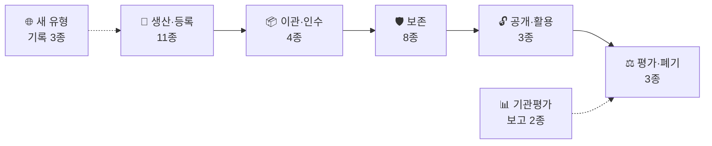
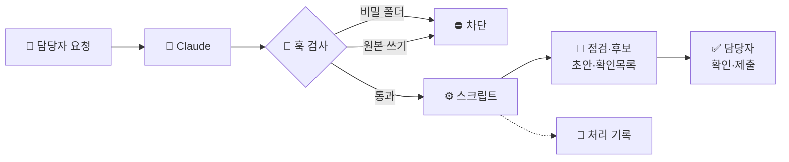

<div align="center">


**공공기관 기록관리 담당자를 위한 Claude 플러그인 마켓플레이스**

생산현황 통보부터 이관·보존·공개·평가·폐기까지 —<br>
반복되는 점검과 서식 작성은 스크립트가, 판단과 제출은 사람이.


**[📖 사용 안내](docs/README.md)** · [🚀 처음 시작하기](docs/getting-started.md) · [🧰 스킬 사용법](docs/skills.md) · [📅 업무 달력](docs/calendar.md) · [❓ FAQ](docs/faq.md)

</div>

---

## ✨ 무엇을 하나요

기록관리 담당자의 일 년은 **반복 점검**과 **서식 채우기**로 가득합니다. 등록정보를 부서별·보존기간별로 세고, 회의록 구성 요소를 하나하나 확인하고, 이관 목록과 상자를 맞춰 보고, 보존기간이 끝난 기록물로 평가심의서를 씁니다.

이 플러그인을 설치하면 Claude Code에게 **"올해 생산현황 통보서 만들어줘"** 라고 말하는 것만으로 이 일을 시작할 수 있습니다. 병원의 검사실이 혈액을 분석하고 의사가 진단하듯, **스크립트는 점검·후보·초안을 만들고 담당자는 확인하고 결정합니다.**

| 이전 | 이후 |
|---|---|
| 엑셀 피벗으로 부서×보존기간 집계, 서식 1~11에 손으로 옮겨 적기 | 입력 폴더 하나 → 통보서식 서식 1~11 자동 채움 + `통보전_확인.md` |
| 이관 목록과 실물 상자를 눈으로 대조 | 빠진 것·남는 것·이름 다른 것을 시트로 |
| 비공개 기록물 중 재분류 대상 찾기 | 올해 심의 대상과 사유 결함 후보를 자동 추출 |
| PDF/A 변환 후 "됐겠지" | veraPDF로 적합·부적합(조항)까지 확인 |

---

## ⚠️ 2027년 1월 1일부터 바뀌는 것

개정 시행령(2026. 8. 25. 공포)·시행규칙(2026. 9. 11.)의 일부 조문이 **2027. 1. 1.** 시행됩니다. [transfer-schedule](plugins/records-skills/skills/transfer-schedule)이 두 규정을 나란히 계산합니다.

| 무엇 | 지금(2026. 12. 31.까지) | 2027. 1. 1.부터 |
|---|---|---|
| 처리과 → 기록관 이관 | 매년 전년도분, 비전자는 기산일부터 2년 범위 보관 후 | **기산일부터 1년 안** |
| 이관 연장 | 기록관 미설치·수시 참고 시 기산일부터 10년 범위 | **기록관과 협의해 1년 범위**, 별지 제1호의2 목록 첨부(미설치 기관은 5년) |
| 암호화 기록물 | — | 이관 때 **암호화 기록물 목록과 해제 정보 첨부**(시행령 제31조의2) |

**경과조치(부칙):**
- 2027. 1. 1. 당시 2년 범위로 보관 중인 비전자기록물과 그 전에 받은 연장은 **종전 규정**을 따릅니다.
- 2026. 8. 25. 당시 기산일부터 5년이 이미 지난 30년 이상 기록물(종료연도 2020년 이전)의 영구 이관은 **종전 10년** 기준입니다.
- 2028. 1. 1.부터는 자체 보존하는 **영구** 기록물도 70년 경과 후 평가합니다.

---

## 🧭 기록물 생애주기와 스킬



---

## 🚀 빠른 시작

> 처음이라면 **[처음 시작하기](docs/getting-started.md)** 를 따라 하세요. Python·Claude Code 설치부터 첫 결과까지 그림과 함께 차례로 안내합니다(30분).

| 단계 | 할 일 | 자세히 |
|---|---|---|
| ① | **Python 3.10+** 설치 (Windows는 **Git for Windows**도) + `python -m pip install openpyxl pypdf pikepdf pillow numpy python-docx python-hwpx holidays` | [1단계](docs/getting-started.md#1단계-python-설치-스크립트를-돌리는-엔진) |
| ② | **Claude Code** 설치·로그인 — Windows `irm https://claude.ai/install.ps1 \| iex` · macOS `curl -fsSL https://claude.ai/install.sh \| bash` | [2단계](docs/getting-started.md#2단계-claude-code-설치와-로그인) |
| ③ | 비공개 저장소 **접근 권한** 받기 + `gh auth login` | [3단계](docs/getting-started.md#3단계-저장소-접근-권한) |
| ④ | 플러그인 설치 (아래) | [4단계](docs/getting-started.md#4단계-플러그인-설치) |
| ⑤ | 작업 폴더에 [`templates/`](plugins/records-skills/templates)의 `CLAUDE.md`·`.claude/settings.json` 복사 | [5단계](docs/getting-started.md#5단계-작업-폴더-준비-한-번만) |
| ⑥ | `비밀/시험.txt 읽어줘` → **차단되면 정상** | [7단계](docs/getting-started.md#7단계-보호-장치가-켜졌는지-꼭-확인하기) |

**플러그인 설치** (Claude Code 안에서)

```text
/plugin marketplace add changgi/archive-bm-tools
/plugin install records-skills@changgi-archive-bm-tools
```

설치 범위는 **Install for you (user scope)** 를 고릅니다. `/`를 눌러 `/records-skills:…`가 보이면 끝입니다.

**기관 폴더 이름 맞추기**(선택): `/plugin configure records-skills@changgi-archive-bm-tools` (또는 `/plugin` → **Installed** → `records-skills` → **Configure options**). 비워 두면 비밀 폴더 `비밀,secret,classified`, 원본 폴더 `원본,보존,originals,preserved`를 씁니다.

**새 버전 받기**: `/plugin` → **Marketplaces** → `changgi-archive-bm-tools` → **Update marketplace** (또는 `claude plugin update records-skills@changgi-archive-bm-tools`)

**말로 시작하기** — 가상 자료 [`examples/입력/`](examples/입력)로 바로 연습할 수 있습니다([결과 미리 보기](examples/결과예시)).

```text
입력 폴더 자료로 2025년 생산분 생산현황 통보서 만들어줘.
이관 목록.xlsx랑 이관파일 폴더 대조해서 빠진 거 찾아줘.
비공개 기록물 목록에서 올해 재분류 심의 대상 뽑아줘.
보존대상 폴더 문서들 PDF/A로 바꾸고 veraPDF로 확인해줘.
```

---

## 🧰 스킬 34종

> 스킬마다 준비할 파일·말하는 법·받는 결과·주의할 점은 **[스킬 34종 사용법](docs/skills.md)**, 언제 무엇을 쓰는지는 **[연간 업무 달력](docs/calendar.md)** 에 있습니다.

<details open>
<summary><b>📝 생산·등록 (11)</b></summary>

| 스킬 | 하는 일 |
|---|---|
| [production-status-report](plugins/records-skills/skills/production-status-report) | 생산현황 통보서식 서식 1~11 채우기, 입력 폴더 일괄 실행(`run_all.py`) |
| [records-register-audit](plugins/records-skills/skills/records-register-audit) | 정리 기간 등록정보와 실물 점검표 대조(시행규칙 제14조) |
| [records-qa-gate](plugins/records-skills/skills/records-qa-gate) | 내보내기 전 목록·메타데이터·이관 패키지 품질 관문, 열 이름 맞춤(`header_check`) |
| [metadata-autofill](plugins/records-skills/skills/metadata-autofill) | 본문에서 제목·생산기관·생산일자·문서번호 후보를 근거 위치와 함께 |
| [docno-extract](plugins/records-skills/skills/docno-extract) | 문서번호 추출, 물결표(~) 범위를 낱개로 펼치기 |
| [task-suggest](plugins/records-skills/skills/task-suggest) | 제목으로 공통업무 단위과제·보존기간 후보 |
| [records-schedule-check](plugins/records-skills/skills/records-schedule-check) | 기록관리기준표 관리항목 점검(NAK 4:2025) |
| [typed-records-check](plugins/records-skills/skills/typed-records-check) | 회의록 구성 요소 8가지, 시청각 생산정보 |
| [publications-check](plugins/records-skills/skills/publications-check) | 발간등록번호·발간주기·송부 책자 3부 |
| [admin-artifacts-check](plugins/records-skills/skills/admin-artifacts-check) | 행정박물 기본정보 11항목·유형 7·재질 13종·이관 기한(별표 4·5) |
| 🆕 [records-forms](plugins/records-skills/skills/records-forms) | 시행규칙 별지 서식 작성 — 색인목록(쪽표시 자동), 반출·반입서, 보존·복원처리서, 전자매체 수록계획서, 발간등록 신청, 폐기 금지 요청·해제·연장, 부기·정정 요청 |

</details>

<details>
<summary><b>📦 이관·인수 (4)</b></summary>

| 스킬 | 하는 일 |
|---|---|
| 🆕 [transfer-schedule](plugins/records-skills/skills/transfer-schedule) | 이관 기한 계산 — 현행·2027. 1. 1. 시행 규정(기산일부터 1년), 비치기록물 연장 신청 기한, 영구 이관 연도, 별지 제1호의2 연장 목록, 암호화 기록물 목록 |
| [transfer-reconcile](plugins/records-skills/skills/transfer-reconcile) | 이관 목록과 파일·상자 대조, 통합(전자+비전자) 이관 붙임 후보 |
| [transfer-triage](plugins/records-skills/skills/transfer-triage) | 인수·기증 폴더 첫 진단 — 포맷 분포·중복·위험 파일 |
| [format-identify](plugins/records-skills/skills/format-identify) | 내용으로 실제 포맷 식별, 확장자 불일치 |

</details>

<details>
<summary><b>🛡️ 보존 (8)</b></summary>

| 스킬 | 하는 일 |
|---|---|
| [preservation-convert](plugins/records-skills/skills/preservation-convert) | PDF/A-1b 변환, veraPDF 검증, 날짜 맞춤 |
| [preservation-inspection](plugins/records-skills/skills/preservation-inspection) | 정수점검·상태검사 주기, 별지 제7호서식 작업지 |
| [fixity-check](plugins/records-skills/skills/fixity-check) | SHA-256 기준선과 정기 대조 |
| [scan-qc](plugins/records-skills/skills/scan-qc) | 스캔 이미지 DPI·기울기·빈 면·밝기 |
| [stack-environment](plugins/records-skills/skills/stack-environment) | 서고 온습도 기록을 시행령 별표 6 기준(매체별)에 견줌, 이탈 시간, 서고 면적, 장비 점검표, 🆕 NAK 11 서고 점검표·권 수 환산·검·교정 주기 |
| [box-labels](plugins/records-skills/skills/box-labels) | 보존상자 편성(생산연도·보존기간·단위과제별), 별표 6 상자 표지 PDF·HTML, 철당 100매 분권 후보 |
| 🆕 [vital-records](plugins/records-skills/skills/vital-records) | 필수기록물 필수성 평가표(기능성·고유성·증거성), 보호기간 점검, 관리목록표, 복본·분산(10km) 점검, 10월 31일 검토 기한 — NAK 2-2 |
| 🆕 [disaster-recovery](plugins/records-skills/skills/disaster-recovery) | 수해·화재 피해 종이기록물 응급복구 순서, 48시간 기한·즉시 냉동동결·곰팡이 분리, 포장 라벨, 재질별 건조 방법, 부속서 A·C·D·E, 대피 우선순위 — NAK 38 |

</details>

<details>
<summary><b>🔓 공개·활용 (3)</b></summary>

| 스킬 | 하는 일 |
|---|---|
| [access-request](plugins/records-skills/skills/access-request) | 정보공개 결정·연장·이의신청 기한(공휴일 반영) |
| [disclosure-reclass](plugins/records-skills/skills/disclosure-reclass) | 공개 재분류 심의 대상, 비공개 사유 결함, 이관 전 재분류 |
| [pii-redact](plugins/records-skills/skills/pii-redact) | 주민등록번호·전화번호 등 개인정보 후보와 부분공개용 가림 목록 |

</details>

<details>
<summary><b>⚖️ 평가·폐기 (3)</b></summary>

| 스킬 | 하는 일 |
|---|---|
| [retention-review](plugins/records-skills/skills/retention-review) | 보존기간 대조 — 기관 기준표·공통업무 준칙·NAK 39 제정(안) |
| [disposal-dossier](plugins/records-skills/skills/disposal-dossier) | 기록물평가심의서·의견조회표(별지 제10호) |
| [email-appraisal](plugins/records-skills/skills/email-appraisal) | MBOX·EML 이메일 기록 평가 |

</details>

<details>
<summary><b>🌐 새 유형 기록 (3)</b></summary>

| 스킬 | 하는 일 |
|---|---|
| [web-records-check](plugins/records-skills/skills/web-records-check) | 누리집 수집 준비도(robots·사이트맵·리다이렉션), WARC 대조 |
| [dataset-schedule](plugins/records-skills/skills/dataset-schedule) | 행정정보 데이터세트 A·B①~④·C 유형 후보, 선정 협의 서식 |
| [classified-records-check](plugins/records-skills/skills/classified-records-check) | 비밀기록물 서식 10·11 — **담당자가 비밀 전용 장비에서만 실행** |

</details>

<details>
<summary><b>📊 기관평가·보고 (2)</b></summary>

| 스킬 | 하는 일 |
|---|---|
| [evaluation-readiness](plugins/records-skills/skills/evaluation-readiness) | 기록관리 기관평가 지표별 증빙 점검 |
| [hwpx-report](plugins/records-skills/skills/hwpx-report) | 마크다운 → 한글(HWPX) 보고서, 기관 서식 채움 |

</details>

---

## 🔒 안전장치

> 세 겹의 잠금, 막는 명령 전체, 보안 담당자 검토용 요약은 **[안전장치](docs/safety.md)** 에 있습니다.



- **비밀기록물은 Claude가 열지 않습니다.** `비밀` 폴더의 읽기와 명령 실행을 훅이 막고, 비밀 관련 스킬은 담당자가 비밀 전용 장비에서 직접 실행합니다.
- **원본은 읽기만 합니다.** 결과는 언제나 새 파일로 씁니다. 산출 폴더가 비어 있지 않으면 덮어쓰지 않습니다.
- **결정은 사람이 합니다.** 폐기·이관·공개 결정과 제출은 스크립트가 하지 않습니다.
- **모든 처리를 기록합니다.** 어떤 도구가 언제 무엇을 했는지 로그로 남습니다.

---

## 📚 근거 법령과 자료

| 근거 | 확인 |
|---|---|
| 공공기록물 관리에 관한 법률·시행령(2026. 8. 25. 개정)·시행규칙(2026. 9. 11. 개정) | 국가법령정보센터(law.go.kr) 원문 |
| 「2026년 기록물관리 지침」 | 국가기록원(archives.go.kr) |
| 생산현황 통보서식, 공통업무 보존기간 준칙 | 국가기록원 공개 자료 |
| NAK 2-2:2025(v1.2) 필수기록물 선별·보호 · NAK 38:2024(v1.0) 재난 피해 종이기록물 응급복구 · NAK 11:2025(v2.0) 보존시설·장비·환경 기준 | 국가기록원 표준 원문 PDF (2026-11-20 내려받아 확인) |
| NAK 10:2026(v1.5) 확정 · NAK 17:2026(v1.4)안 · NAK 39:2026(v1.0) 제정(안) | 국가기록원 고시·예고 |
| 시행령 별표 1~6(보존기간·보존방법·상태검사·행정박물·시설환경) · 시행규칙 별표 1~16·별지 제1~25호 | 국가법령정보센터 별표·서식 원문(2026-11-20 확인 — [기록](plugins/records-skills/skills/records-qa-gate/references/law-forms-2026-11-20.md)) |
| 국가기록원 행정규칙(고시 제2025-10호로 재고시된 NAK 표준, 부기·정정 처리 기준 훈령 제224호 등) · 간행물 발간등록 안내 | 국가법령정보센터 행정규칙, 국가기록포털 |

지침에 남은 개정 전 문구(예: 비밀기록물 이관 10년)는 **개정 법령과 표준을 따릅니다.** 차이는 [`guideline-2024-notes.md`](plugins/records-skills/skills/records-qa-gate/references/guideline-2024-notes.md)에 정리했습니다.

---

## 🧪 시험

```bash
python plugins/records-skills/tests/run_tests.py
```

60개(veraPDF가 PATH에 있으면 61개) — 스킬 34종의 주요 계산과, 보호 훅이 Windows처럼 `python3`가 없거나 가짜일 때도 꺼지지 않는지까지 확인합니다. 필요 패키지: `openpyxl` `pypdf` `pikepdf` `pillow` `numpy` (선택: `python-docx` `python-hwpx` `holidays`, LibreOffice). Python 3.11·3.12·3.13에서 확인했고, [GitHub Actions](.github/workflows/test.yml)로 3.10~3.13을 돌립니다.

---

## 📄 이용 조건

코드는 [MIT](LICENSE), 문서·설명은 CC BY 4.0입니다. 플러그인에 든 국가기록원 서식·준칙 표는 공공저작물(저작권법 제24조의2)로, 출처를 밝혀 씁니다.

<div align="center">

만든 사람 **Song Chang-gi** · [chgsong@naver.com](mailto:chgsong@naver.com) · [github.com/changgi](https://github.com/changgi)

자세한 변경 내역은 [records-skills README](plugins/records-skills/README.md)에 있습니다.

</div>
