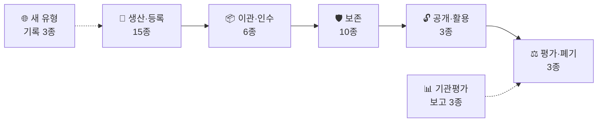
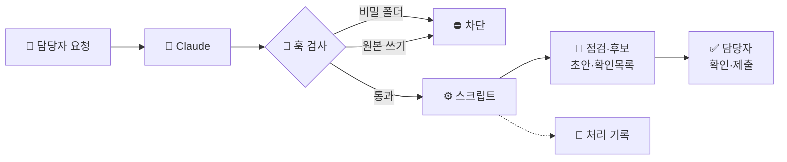

<div align="center">


**공공기관 기록관리 담당자를 위한 Claude 플러그인 마켓플레이스**

생산현황 통보부터 이관·보존·공개·평가·폐기까지 —<br>
반복되는 점검과 서식 작성은 스크립트가, 판단과 제출은 사람이.


**[🌐 소개 페이지](https://changgi.github.io/archive-bm-tools/)** · **[📖 사용 안내](docs/README.md)** · [🚀 처음 시작하기](docs/getting-started.md) · [🧰 스킬 사용법](docs/skills.md) · [🧪 예제](examples/시나리오) · [📅 업무 달력](docs/calendar.md) · [❓ FAQ](docs/faq.md)

</div>

---

## ✨ 무엇을 하나요

기록관리 담당자의 일 년은 **반복 점검**과 **서식 채우기**로 가득합니다. 등록정보를 부서별·보존기간별로 세고, 회의록 구성 요소를 하나하나 확인하고, 이관 목록과 상자를 맞춰 보고, 보존기간이 끝난 기록물로 평가심의서를 씁니다.

이 플러그인을 설치하면 Claude Code에게 **"올해 생산현황 통보서 만들어줘"** 라고 말하는 것만으로 이 일을 시작할 수 있습니다. 병원의 검사실이 혈액을 분석하고 의사가 진단하듯, **스크립트는 점검·후보·초안을 만들고 담당자는 확인하고 결정합니다.**

| 이전 | 이후 |
|---|---|
| 엑셀 피벗으로 부서×보존기간 집계, 서식 1~11에 손으로 옮겨 적기 | 입력 폴더 하나 → 통보서식 서식 1~11 자동 채움 + `통보전_확인.md` |
| 이관 목록과 실물 상자를 눈으로 대조 | 빠진 것·남는 것·이름 다른 것을 시트로 |
| 비공개 기록물 중 재분류 대상 찾기 | 올해 심의 대상과 사유 결함 후보를 자동 추출 |
| PDF/A 변환 후 "됐겠지" | veraPDF로 적합·부적합(조항)까지 확인 |

---

## 🆕 v2.22.0에서 달라진 것

- 🆕 **record-by-design**(43번째 스킬): 현용 단계에서 만든 파일이 "누가·무슨 업무로·왜·무엇과 이어져" 만들었는지와 원본 그대로임을 스스로 증명하는 기록 패키지로 만들고, 같은 메타데이터에서 여러 매개로 다시 만듭니다. `batch`로 목록 한 장에서 여러 패키지를, `catalog`로 패키지 전체의 목록·공개데이터(JSONL)·연결 그래프(JSON-LD)·검색 페이지를 만듭니다. [사용법](docs/skills.md#43-record-by-design--생산-시점-기록화)
- 🔭 **근거 자료 변화 감시**: 국가기록포털·법제처 입법예고·국가법령정보센터 33곳을 3주에 한 번(GitHub Actions) 지난번과 비교해, 새 게시물·첨부·법령 시행일이 바뀌면 보고서와 PR을 엽니다. [사용법](docs/skills.md#3-records-qa-gate--내보내기-전-품질-관문)
- 🔁 **생산 시점 기록화 자동화**: `sweep`(업무 폴더에서 새·바뀐 파일만, 바뀐 파일은 '개정' 관계), `catalog`에 OAI-PMH Dublin Core·Atom 피드·schema.org 구조화 데이터·CSVW·sitemap 추가
- 🧭 **업무과정 분석·평가 작업지**(KS X ISO TR 26122·TR 21946): 기록관리기준표를 만들거나 정비할 때 단위과제별 순차 분석·기록 요구·위험 평가, `sweep` 설정 초안까지
- 🔒 **비밀기록물 공개 지침 3종 반영**: 보존기간 말일 ≥ 보호기간 말일 계산 바로잡음, 유형별 이관 준비·재분류 검토서 시트
- 📚 **KS 12종**: 원문은 유료라 공개 초록·목차로 범위를 확인해 [대응표](plugins/records-skills/skills/records-qa-gate/references/ks-standards-2026-11-21.md)로 정리
- 🏫 **school-records**(44번째 스킬): 「2025년 학교기록물 관리 지침」 — 졸업대장·시험기록물·학교폭력·보건·급식·동의서, 이관 시기, 건명 개인정보, 문서고 대장, 폐교 인계. [사용법](docs/skills.md#44-school-records--학교기록물-점검)
- 🌐 **해외표준 134건 전수 대조**: 첨부 67건 원문을 모두 읽고 [대조표](plugins/records-skills/skills/records-qa-gate/references/foreign-standards-2026-11-21.md)로 정리(반영 12·반영됨 16·참고 99·보류 7), 서고 '참고 해외 기준'(NISO·뉴질랜드·호주), 건조 방식·외부 위탁, 원본 열람 취급 안내
- 🖼️ **전시 환경 점검**(별표 6·ANSI/NISO Z39.79: 조도·자외선·전시 기간·재전시 간격) · 🔥 **화재 예방 자체 점검표**(해외표준 문화기관용 양식 구성) · 🗺️ **기록 맥락 지도**(기관→부서→단위과제→기록, `--public-only`로 공개분만 게시)
- 🗄️ **데이터세트 평가·폐기 준비**(실행매뉴얼 2020): 보존기간+처분제약이 지난 데이터 영역 → 평가심의서, 확인용 SQL(SELECT만), 폐기 결과 기록부
- 📗 **간행물 2026 송부지침**(2026. 10.): 기관 기호표·발간주기 기호·생략대상 유형과 기관·비공개 사유 점검
- 🏺 **행정박물 관리대상 선별**(행정박물 관리지침 2021 표 4): 7개 기준 처리과·기록관 점수 → 70점 중 36점 이상 관리대상, 공직자 선물·관인 폐기공고 안내
- 🔄 **법정 보존기간 목록 자동 갱신**(`statutory_watch.py`): 3주 감시 때 '최신법령'·'최신행정규칙'에서 목록에 있는 법령이 개정되면 그 원문만 다시 읽어 보존기간 조문 변화(🆕·➖)를 보고하고 목록을 고친 PR을 엶(시행 전 개정은 알리기만). 외부 API·비용 없이 빨라짐: 이미 읽은 판본은 건너뛰고 원문은 3개씩 동시에 받아 359초 → 22초(다시 돌릴 때)
- 🧭 **보존 조문 위임 추적기**(`retention_tree.py`): 한 조문 안의 항·호·단서별 보존기간을 나누고 '○○령으로 정하는 서류'·'보존기간 연장 단서'·'장관이 고시하는 물질'을 법률 → 시행령·시행규칙 → 고시까지 끝까지 따라감(예: 산업안전보건법 제164조 → 시행규칙 제241조 → 작업환경측정 고시·근로자 건강진단 실시기준의 30년 물질). 현행 법령 5,632개 전부와 행정규칙·자치법규까지 9,707행, 외부 API 없음
- 📜 **법정 보존기간 연혁**(`statutory_history.py`): 옛 기록을 평가할 때 생산 당시 법정 기간을 확인 — 점검 표 법령·고시 24개의 연혁 판본 1,414개에서 기록 종류별 기간 변화를 표로 정리(예: 재난상황의 기록 3년 → 2014년부터 5년). `--find 재난상황 --year 2010`
- 🧠 **보존 의무 판정기**(`retention_judge.py`): 문장이 기록 보존 의무인지 확률로 답하는 작은 모형(255KB, 컴퓨터 안에서 계산·API 없음). 목록 10,084건에 '판정' 칸(의무 9,189·확인 필요 653·의무 아님 가능성 242)을 매겨 '24시간 운영체제 유지'·'3년간 고용 유지' 같은 잡음을 점검 후보에서 뺌. 처음 보는 문장 40개 시험에서 의무 문장을 하나도 놓치지 않음
- 🧾 **생산 시점에 보존기간 법적근거 남기기**: record-by-design이 기록 패키지를 만들 때 단위과제의 법정 보존기간·근거(예: 처방전 → 「의료법 시행규칙」 제15조①3호 2년)를 `metadata.json`·RiC-O `rico:isOrWasRegulatedBy`·사건 기록에 남기고, 정한 기간이 법정 최소보다 짧거나 파기 상한보다 길면 바로 알림. 평가 작업지의 '법규상 요구' 칸도 미리 채움
- ⚖️ **개별 법령 법정 보존기간 전수 조사·점검**(`statutory_check.py`): 국가법령정보센터 조문 검색으로 '년'·숫자 표현 28가지와 별표·서식 본문 검색으로 찾은 현행 법령 583개·별표·서식 PDF 9,730개·한글 파일 815개·행정규칙 1,703개·자치법규 3,970개(246개 지자체)의 원문에서 보존·보관 기간 10,084건을 모아(‘최소 보존’과 ‘지나면 파기(상한)’ 구분) [전체 목록](plugins/records-skills/skills/retention-review/assets/law/statutory_catalog.csv)으로 만들고(`--find`로 검색, 지자체는 `--org`로 자기 조례까지, `statutory_catalog_build.py`로 다시 만들기), 그중 기관 기준표와 맞출 44종(근로기준법·산업안전보건법·국세기본법·소방·의료법·장애인 인식개선교육·개인정보 접속기록·재난상황 기록·재산등록 자료·보조사업 자료 등)으로 '법정 최소 미달'과 맞출 보존기간을 표시
- 🏥 **의료법 법정 보존기간 점검**: 의료기관 기준표 대조에 「의료법 시행규칙」 제15조① 9종(진료기록부·수술기록 10년, 환자 명부·검사소견·방사선 사진·간호·조산 5년, 진단서 부본 3년, 처방전 2년)을 넣어 더 짧은 과제를 '법정 최소 미달'로 표시. 스킬이 근거로 쓰는 법령 4개(의료법 시행규칙·정보공개법 시행규칙·재난안전법·개인정보 보호법)를 감시 목록에 추가
- python-hwpx 7.0 호환, GitHub Actions에서 LibreOffice까지 설치해 시험

### v2.21.0

국가기록포털 **표준·지침·매뉴얼** 6개 탭(표준 33·지침 18·매뉴얼 12·규격서식 5·KS 11·해외 120)과 **기록물분류기준** 3개 메뉴를 전부 열어, 첨부 파일까지 읽고 스크립트로 옮겼습니다. 게시물마다 어느 스킬이 맡는지는 [전수 대응표](plugins/records-skills/skills/records-qa-gate/references/standards-menu-2026-11-21.md)에 있습니다.

| 영역 | 새로 할 수 있는 일 | 근거 자료 |
|---|---|---|
| 📦 청사 이전 | 새 스킬 **office-relocation** — 보유현황 통계, 평가·폐기 후보, 관리번호·레이블, 이송 박스·배가표, 점검표 | 공공기관 청사 이전 대비 기록관리 업무 매뉴얼 |
| 🏛️ 기관 통폐합 | 두 기관 이상 단위과제 맞대기 → 문제유형·통합 기록관리표 초안 | 기관 통폐합 분류체계 정비 방안 연구(2026) |
| 🗂️ 일괄등록 | RAMP 일괄등록 파일 만들기, 행정정보DB구축 결과(목록+이미지 폴더) 점검 | RAMP 일괄등록 규격(2024), 행정정보DB구축 기록물 규격(2023) |
| ⚖️ 보존기간 | 1964~1997 공문서분류표, 2012·2021 고유업무 준칙, 분류기준표 2,416건, 대학·의료기관 가이드 | 기록물분류기준 메뉴, 매뉴얼 탭 |
| 🛡️ 보존·재난 | 행정박물 응급조치, 취약 종이기록물 예방조치, 첫 상태검사 우선순위, 해충 트랩 | 지침 탭(2024·2025), 소독대상 선별 매뉴얼(2022) |
| 📷 시청각 | 사진 등록대상 선정(연사 대표·노출·흑백·저해상도) | 시청각기록물 관리지침(2024) |
| 📊 기관평가 | 2026 평가 지표별 전국 평균, 공공기관·대학 수행업무 점검표 | 2026 기관평가 결과, 2026 지침 3종 |

**바로 따라 해 보기** — [업무 시나리오 예제 8가지](examples/시나리오)에 가상 입력과 실제 결과 파일이 있습니다.

```text
우리 대학 기록관리기준표를 대학 가이드랑 비교해서 짧게 잡힌 과제 찾아줘.
DB구축 업체가 넘긴 목록이랑 이미지 폴더, 일괄등록 규격대로 점검해줘.
어제 아침 9시에 침수된 행정박물 목록이야. 응급조치 순서 정해줘.
가청이랑 나청 단위과제 목록 맞대서 통합 기록관리표 초안 만들어줘.
```

---

## ⚠️ 2027년 1월 1일부터 바뀌는 것

개정 시행령(2026. 8. 25. 공포)·시행규칙(2026. 9. 11.)의 일부 조문이 **2027. 1. 1.** 시행됩니다. [transfer-schedule](plugins/records-skills/skills/transfer-schedule)이 두 규정을 나란히 계산합니다.

| 무엇 | 지금(2026. 12. 31.까지) | 2027. 1. 1.부터 |
|---|---|---|
| 처리과 → 기록관 이관 | 매년 전년도분, 비전자는 기산일부터 2년 범위 보관 후 | **기산일부터 1년 안** |
| 이관 연장 | 기록관 미설치·수시 참고 시 기산일부터 10년 범위 | **기록관과 협의해 1년 범위**, 별지 제1호의2 목록 첨부(미설치 기관은 5년) |
| 암호화 기록물 | — | 이관 때 **암호화 기록물 목록과 해제 정보 첨부**(시행령 제31조의2) |

**2027. 4. 14.부터(법률 개정, 2026. 10. 13. 공포):** 영구기록물관리기관 이관 대상이 '보존기간 30년 이상'에서 **'영구 + 대통령령으로 정하는 기록물'**로 바뀌고, 기록관·특수기록관이 없는 기관을 위한 **준기록관**이 생깁니다. 기록물공개심의회는 7~15명(민간 3분의 2 이상)으로 늘고 **지방자치단체지정기록물**이 신설됩니다. 받치는 시행령 개정은 아직 나오지 않아, transfer-schedule은 30년·준영구에 '확인' 표시만 붙입니다([확인 기록](plugins/records-skills/skills/records-qa-gate/references/law-check-2026-11-20.md)).

**경과조치(부칙):**
- 2027. 1. 1. 당시 2년 범위로 보관 중인 비전자기록물과 그 전에 받은 연장은 **종전 규정**을 따릅니다.
- 2026. 8. 25. 당시 기산일부터 5년이 이미 지난 30년 이상 기록물(종료연도 2020년 이전)의 영구 이관은 **종전 10년** 기준입니다.
- 2028. 1. 1.부터는 자체 보존하는 **영구** 기록물도 70년 경과 후 평가합니다.

---

## 🧭 기록물 생애주기와 스킬



---

## 🚀 빠른 시작

> 처음이라면 **[처음 시작하기](docs/getting-started.md)** 를 따라 하세요. Python·Claude Code 설치부터 첫 결과까지 그림과 함께 차례로 안내합니다(30분).

| 단계 | 할 일 | 자세히 |
|---|---|---|
| ① | **Python 3.10+** 설치 (Windows는 **Git for Windows**도) + `python -m pip install openpyxl pypdf pikepdf pillow numpy python-docx "python-hwpx<7" holidays` | [1단계](docs/getting-started.md#1단계-python-설치-스크립트를-돌리는-엔진) |
| ② | **Claude Code** 설치·로그인 — Windows `irm https://claude.ai/install.ps1 \| iex` · macOS `curl -fsSL https://claude.ai/install.sh \| bash` | [2단계](docs/getting-started.md#2단계-claude-code-설치와-로그인) |
| ③ | 저장소는 **공개** — 권한 없이 바로 설치(방화벽 환경이면 `gh auth login`) | [3단계](docs/getting-started.md#3단계-저장소-접근-권한) |
| ④ | 플러그인 설치 (아래) | [4단계](docs/getting-started.md#4단계-플러그인-설치) |
| ⑤ | 작업 폴더에 [`templates/`](plugins/records-skills/templates)의 `CLAUDE.md`·`.claude/settings.json` 복사 | [5단계](docs/getting-started.md#5단계-작업-폴더-준비-한-번만) |
| ⑥ | `비밀/시험.txt 읽어줘` → **차단되면 정상** | [7단계](docs/getting-started.md#7단계-보호-장치가-켜졌는지-꼭-확인하기) |

**플러그인 설치** (Claude Code 안에서)

```text
/plugin marketplace add changgi/archive-bm-tools
/plugin install records-skills@changgi-archive-bm-tools
```

설치 범위는 **Install for you (user scope)** 를 고릅니다. `/`를 눌러 `/records-skills:…`가 보이면 끝입니다.

**기관 폴더 이름 맞추기**(선택): `/plugin configure records-skills@changgi-archive-bm-tools` (또는 `/plugin` → **Installed** → `records-skills` → **Configure options**). 비워 두면 비밀 폴더 `비밀,secret,classified`, 원본 폴더 `원본,보존,originals,preserved`를 씁니다.

**새 버전 받기**: `/plugin` → **Marketplaces** → `changgi-archive-bm-tools` → **Update marketplace** (또는 `claude plugin update records-skills@changgi-archive-bm-tools`)

**말로 시작하기** — 가상 자료 [`examples/입력/`](examples/입력)로 바로 연습할 수 있습니다([결과 미리 보기](examples/결과예시)).

```text
입력 폴더 자료로 2025년 생산분 생산현황 통보서 만들어줘.
이관 목록.xlsx랑 이관파일 폴더 대조해서 빠진 거 찾아줘.
비공개 기록물 목록에서 올해 재분류 심의 대상 뽑아줘.
보존대상 폴더 문서들 PDF/A로 바꾸고 veraPDF로 확인해줘.
```

---

## 🧰 스킬 44종

> 스킬마다 준비할 파일·말하는 법·받는 결과·주의할 점은 **[스킬 44종 사용법](docs/skills.md)**, 언제 무엇을 쓰는지는 **[연간 업무 달력](docs/calendar.md)** 에 있습니다.

<details open>
<summary><b>📝 생산·등록 (15)</b></summary>

| 스킬 | 하는 일 |
|---|---|
| [production-status-report](plugins/records-skills/skills/production-status-report) | 생산현황 통보서식 서식 1~11 채우기, 입력 폴더 일괄 실행(`run_all.py`) |
| [records-register-audit](plugins/records-skills/skills/records-register-audit) | 정리 기간 등록정보와 실물 점검표 대조(시행규칙 제14조) |
| [records-qa-gate](plugins/records-skills/skills/records-qa-gate) | 내보내기 전 목록·메타데이터·이관 패키지 품질 관문, 열 이름 맞춤(`header_check`) |
| [metadata-autofill](plugins/records-skills/skills/metadata-autofill) | 본문에서 제목·생산기관·생산일자·문서번호 후보를 근거 위치와 함께 |
| [docno-extract](plugins/records-skills/skills/docno-extract) | 문서번호 추출, 물결표(~) 범위를 낱개로 펼치기 |
| [task-suggest](plugins/records-skills/skills/task-suggest) | 제목으로 공통업무 단위과제·보존기간 후보 |
| [records-schedule-check](plugins/records-skills/skills/records-schedule-check) | 기록관리기준표 관리항목 점검(NAK 4:2025) |
| [listing-qa](plugins/records-skills/skills/listing-qa) | 목록 작성·디지털화 사업 검수 — 면표시·편철 순서·쪽수↔이미지·작업자별 표본 3%·99.9% — NAK 23, 🆕 RAMP 일괄등록 파일(2024 규격)·행정정보DB구축 일괄등록 점검(2023 규격, 이미지 폴더 포함) |
| 🆕 [official-doc-check](plugins/records-skills/skills/official-doc-check) | 공문서 표기 점검 — 날짜·시간·금액(한글 대조)·항목 기호·붙임·끝 표시 — 행정업무규정 제7조·시행규칙 제2·4조 |
| 🆕 [archival-description](plugins/records-skills/skills/archival-description) | 기록물 기술 점검 — 필수요소 6개, 일자 표기·연호 환산, 계층별 일자 — NAK 13 |
| [typed-records-check](plugins/records-skills/skills/typed-records-check) | 회의록 구성 요소 8가지, 시청각 생산정보, 🆕 사진 등록대상 선정(연사 대표·노출·흑백 변환·저해상도) — 시청각기록물 관리지침 2024 |
| [publications-check](plugins/records-skills/skills/publications-check) | 발간등록번호·발간주기·송부 책자 3부 |
| [admin-artifacts-check](plugins/records-skills/skills/admin-artifacts-check) | 행정박물 기본정보 11항목·유형 7·재질 13종·이관 기한(별표 4·5) |
| 🆕 [record-by-design](plugins/records-skills/skills/record-by-design) | 생산 시점 기록화 — 맥락(단위과제·생산자·업무활동·관계)과 증거성(SHA-256·사건 이력)을 붙인 BagIt 패키지, 메타데이터 하나에서 등록대장·공개데이터·요약 HTML·카드·RiC-O 연결 데이터, 고정성 재확인 — NAK 8·RiC-O·PREMIS |
| 🆕 [school-records](plugins/records-skills/skills/school-records) | 학교기록물 — 졸업대장·시험기록물·학교폭력·보건·급식·동의서 사안별 관리, 이관 시기(기산일부터 2년·전자 1년·연장 10년), 건명 개인정보, 문서고 대장, 폐교 인계 계획 — 2025년 학교기록물 관리 지침 |
| 🆕 [records-forms](plugins/records-skills/skills/records-forms) | 시행규칙 별지 서식 작성 — 색인목록(쪽표시 자동), 반출·반입서, 보존·복원처리서, 전자매체 수록계획서, 발간등록 신청, 폐기 금지 요청·해제·연장, 부기·정정 요청 |

</details>

<details>
<summary><b>📦 이관·인수 (6)</b></summary>

| 스킬 | 하는 일 |
|---|---|
| 🆕 [transfer-schedule](plugins/records-skills/skills/transfer-schedule) | 이관 기한 계산 — 현행·2027. 1. 1. 시행 규정(기산일부터 1년), 비치기록물 연장 신청 기한, 영구 이관 연도, 별지 제1호의2 연장 목록, 암호화 기록물 목록 |
| [transfer-reconcile](plugins/records-skills/skills/transfer-reconcile) | 이관 목록과 파일·상자 대조, 통합(전자+비전자) 이관 붙임 후보 |
| [transfer-triage](plugins/records-skills/skills/transfer-triage) | 인수·기증 폴더 첫 진단 — 포맷 분포·중복·위험 파일 |
| [format-identify](plugins/records-skills/skills/format-identify) | 내용으로 실제 포맷 식별, 확장자 불일치 |
| [agency-closure](plugins/records-skills/skills/agency-closure) | 한시·폐지·통합·전환 기관 인계인수 — 관리 주체, 유형별 이관목록, 인계인수서, 체크리스트, 3개월 통보 기한 — NAK 15, 🆕 통폐합 기관 기록관리표 통합 초안(단위과제비교표·문제유형) |
| 🆕 [office-relocation](plugins/records-skills/skills/office-relocation) | 청사 이전·문서고 이전 — 보유현황 통계, 보존기간 확인, 평가·폐기 후보, 관리번호·레이블, 이송 박스·배가표, 추진상황 점검표 — 국가기록원 청사 이전 매뉴얼 |

</details>

<details>
<summary><b>🛡️ 보존 (10)</b></summary>

| 스킬 | 하는 일 |
|---|---|
| [preservation-convert](plugins/records-skills/skills/preservation-convert) | PDF/A-1b 변환, veraPDF 검증, 날짜 맞춤 |
| [preservation-inspection](plugins/records-skills/skills/preservation-inspection) | 정수점검·상태검사 주기, 별지 제7호서식 작업지, 복원처리 계획(심화·예방·응급, 탈산 대상) — NAK 25, 🆕 첫 상태검사 우선순위·해충 트랩 판정·취약 종이기록물 예방조치(간지·보호 폴더·편철 개선) |
| [fixity-check](plugins/records-skills/skills/fixity-check) | SHA-256 기준선과 정기 대조 |
| [scan-qc](plugins/records-skills/skills/scan-qc) | 스캔 이미지 DPI·기울기·빈 면·밝기, 🆕 NAK 26 매체별 해상도·비트심도·포맷·JPEG 품질, 시청각 디지털화 점검 |
| 🆕 [media-check](plugins/records-skills/skills/media-check) | 기록매체 대장 점검(-R/+R, 4/5, 반도체 1년, 테이프 3년, 마이그레이션)과 간이 검사(복사 전·후·해시) — NAK 12 |
| [stack-environment](plugins/records-skills/skills/stack-environment) | 서고 온습도 기록을 시행령 별표 6 기준(매체별)에 견줌, 이탈 시간, 서고 면적, 장비 점검표, 🆕 NAK 11 서고 점검표·권 수 환산·검·교정 주기 |
| [box-labels](plugins/records-skills/skills/box-labels) | 보존상자 편성(생산연도·보존기간·단위과제별), 별표 6 상자 표지 PDF·HTML, 철당 100매 분권 후보 |
| 🆕 [vital-records](plugins/records-skills/skills/vital-records) | 필수기록물 필수성 평가표(기능성·고유성·증거성), 보호기간 점검, 관리목록표, 복본·분산(10km) 점검, 10월 31일 검토 기한, 재난 뒤 피해 평가·업무복구 순서 — NAK 2-2 |
| 🆕 [disaster-recovery](plugins/records-skills/skills/disaster-recovery) | 수해·화재 피해 종이기록물 응급복구 순서, 48시간 기한·즉시 냉동동결·곰팡이 분리, 포장 라벨, 재질별 건조 방법, 부속서 A·C·D·E, 대피 우선순위 — NAK 38, 필름·사진·테이프 등 종이 외 매체 — NAK 2-1, 🆕 행정박물 응급조치(재질 군·직물 48시간·구조 우선순위 1~6등급) |
| 🆕 [security-disaster-plan](plugins/records-skills/skills/security-disaster-plan) | 보안·재난관리 체크리스트, 위험평가표(발생가능성×위험도), 업무별 안전규칙, 임무카드·비상용품 점검, 재난 보고서, 영구기관 RTO·RPO — NAK 2-1 |

</details>

<details>
<summary><b>🔓 공개·활용 (3)</b></summary>

| 스킬 | 하는 일 |
|---|---|
| [access-request](plugins/records-skills/skills/access-request) | 정보공개 결정·연장·이의신청 기한(공휴일 반영), 🆕 처리대장·이의신청대장·운영실태(별지 4·11·12)·별표 수수료 계산 |
| [disclosure-reclass](plugins/records-skills/skills/disclosure-reclass) | 공개 재분류 심의 대상, 비공개 사유 결함, 이관 전 재분류, 🆕 검토서(16칸)·기준서·체크리스트 — NAK 16-1 |
| [pii-redact](plugins/records-skills/skills/pii-redact) | 주민등록번호·전화번호 등 개인정보 후보와 부분공개용 가림 목록 |

</details>

<details>
<summary><b>⚖️ 평가·폐기 (3)</b></summary>

| 스킬 | 하는 일 |
|---|---|
| [retention-review](plugins/records-skills/skills/retention-review) | 보존기간 대조 — 기관 기준표·공통업무 준칙·NAK 39 제정(안), 🆕 중앙행정기관 고유업무 준칙(2021·2012), 옛 공문서분류표(1964~1997), 기관별 분류기준표 색인(2,416건), 대학(201과제)·의료기관(135과제) 가이드 |
| [disposal-dossier](plugins/records-skills/skills/disposal-dossier) | 기록물평가심의서·의견조회표(별지 제10호), 🆕 처분결과 등록·폐기 집행 대조·위탁 폐기 점검 — NAK 5-1 |
| [email-appraisal](plugins/records-skills/skills/email-appraisal) | MBOX·EML 이메일 기록 평가 |

</details>

<details>
<summary><b>🌐 새 유형 기록 (3)</b></summary>

| 스킬 | 하는 일 |
|---|---|
| [web-records-check](plugins/records-skills/skills/web-records-check) | 누리집 수집 준비도(robots·사이트맵·리다이렉션), WARC 대조 |
| [dataset-schedule](plugins/records-skills/skills/dataset-schedule) | 행정정보 데이터세트 A·B①~④·C 유형 후보, 선정 협의 서식 |
| [classified-records-check](plugins/records-skills/skills/classified-records-check) | 비밀기록물 서식 10·11 — **담당자가 비밀 전용 장비에서만 실행** |

</details>

<details>
<summary><b>📊 기관평가·보고 (3)</b></summary>

| 스킬 | 하는 일 |
|---|---|
| 🆕 [system-requirements](plugins/records-skills/skills/system-requirements) | 기록관리·영구·정부산하·생산시스템 기능요건 점검표(원문 762개), 필수 충족률·미충족 — NAK 6·7·20·19 |
| [evaluation-readiness](plugins/records-skills/skills/evaluation-readiness) | 기록관리 기관평가 지표별 증빙 점검, 연간 업무 일정·캘린더(.ics)·기관장 보고 점검표 — NAK 18, 🆕 2026 평가 지표별 전국 평균, 일반·공공기관·대학 지침 수행업무 점검표 |
| [hwpx-report](plugins/records-skills/skills/hwpx-report) | 마크다운 → 한글(HWPX) 보고서, 기관 서식 채움 |

</details>

---

## 🔒 안전장치

> 세 겹의 잠금, 막는 명령 전체, 보안 담당자 검토용 요약은 **[안전장치](docs/safety.md)** 에 있습니다.



- **비밀기록물은 Claude가 열지 않습니다.** `비밀` 폴더의 읽기와 명령 실행을 훅이 막고, 비밀 관련 스킬은 담당자가 비밀 전용 장비에서 직접 실행합니다.
- **원본은 읽기만 합니다.** 결과는 언제나 새 파일로 씁니다. 산출 폴더가 비어 있지 않으면 덮어쓰지 않습니다.
- **결정은 사람이 합니다.** 폐기·이관·공개 결정과 제출은 스크립트가 하지 않습니다.
- **모든 처리를 기록합니다.** 어떤 도구가 언제 무엇을 했는지 로그로 남습니다.

---

## 📚 근거 법령과 자료

| 근거 | 확인 |
|---|---|
| 공공기록물 관리에 관한 법률·시행령(2026. 8. 25. 개정)·시행규칙(2026. 9. 11. 개정) | 국가법령정보센터(law.go.kr) 원문 |
| 「2026년 기록물관리 지침」 | 국가기록원(archives.go.kr) |
| 생산현황 통보서식, 공통업무 보존기간 준칙 | 국가기록원 공개 자료 |
| NAK 6·7·19-1~3·20 시스템 기능요건 · NAK 30 PDF/A-1b · NAK 31-1 NEO2 · NAK 24 보존시설 신축 · NAK 32-1·16-2·5-2·9(참고) · NAK 23:2017(v1.2) 목록 작성·디지털화 작업 · NAK 13:2022(v2.1) 영구기록물 기술규칙 · NAK 18:2022(v1.1) 기관장 책임과 역할 · NAK 21:2018(v1.1) 서비스 표준 · NAK 26:2023(v2.1) 디지털화 기준 · NAK 25:2026(v2.1) 종이기록물 보존·복원 · NAK 16-1:2020(v1.2) 공개관리(생산부서·기록관) · NAK 5-1:2014(v2.2) 평가·폐기(기록관용) · NAK 12:2022(v3.1) 기록매체 요건 · NAK 15:2021(v2.0) 한시·폐지기관 · NAK 2-1:2024(v1.2) 보안 및 재난관리 기준 · NAK 2-2:2025(v1.2) 필수기록물 선별·보호 · NAK 38:2024(v1.0) 재난 피해 종이기록물 응급복구 · NAK 11:2025(v2.0) 보존시설·장비·환경 기준 | 국가기록원 표준 원문 PDF (2026-11-20 내려받아 확인) |
| 국가기록포털 표준·지침·매뉴얼(지침 18·매뉴얼 12·규격서식 5) · 기록물분류기준(보존기간 책정기준·기록물분류기준표·공문서분류 및 보존기간표) | 2026-11-20~21 첨부 파일까지 내려받아 확인 — [전수 대응표](plugins/records-skills/skills/records-qa-gate/references/standards-menu-2026-11-21.md) |
| NAK 10:2026(v1.5) 확정 · NAK 17:2026(v1.4)안 · NAK 39:2026(v1.0) 제정(안) | 국가기록원 고시·예고 |
| 시행령 별표 1~6(보존기간·보존방법·상태검사·행정박물·시설환경) · 시행규칙 별표 1~16·별지 제1~25호 | 국가법령정보센터 별표·서식 원문(2026-11-20 확인 — [기록](plugins/records-skills/skills/records-qa-gate/references/law-forms-2026-11-20.md)) |
| 국가기록원 행정규칙(고시 제2025-10호로 재고시된 NAK 표준, 부기·정정 처리 기준 훈령 제224호 등) · 간행물 발간등록 안내 | 국가법령정보센터 행정규칙, 국가기록포털 |

지침에 남은 개정 전 문구(예: 비밀기록물 이관 10년)는 **개정 법령과 표준을 따릅니다.** 차이는 [`guideline-2024-notes.md`](plugins/records-skills/skills/records-qa-gate/references/guideline-2024-notes.md)에 정리했습니다.

---

## 🧪 시험

```bash
python plugins/records-skills/tests/run_tests.py
```

144개(veraPDF·ffmpeg 유무에 따라 1~2개 달라짐) — 스킬 44종의 주요 계산과, 보호 훅이 Windows처럼 `python3`가 없거나 가짜일 때도 꺼지지 않는지까지 확인합니다. 필요 패키지: `openpyxl` `pypdf` `pikepdf` `pillow` `numpy` (선택: `python-docx` `python-hwpx` `holidays`, LibreOffice). Python 3.11·3.12·3.13에서 확인했고, [GitHub Actions](.github/workflows/test.yml)로 3.10~3.13을 돌립니다.

---

## 📄 이용 조건

코드는 [MIT](LICENSE), 문서·설명은 CC BY 4.0입니다. 플러그인에 든 국가기록원 서식·준칙 표는 공공저작물(저작권법 제24조의2)로, 출처를 밝혀 씁니다.

<div align="center">

만든 사람 **Song Chang-gi** · [chgsong@naver.com](mailto:chgsong@naver.com) · [github.com/changgi](https://github.com/changgi)

자세한 변경 내역은 [records-skills README](plugins/records-skills/README.md)에 있습니다.

</div>
