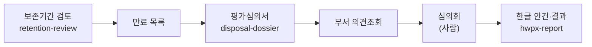

# 연간 업무 달력 — 언제 무엇을 시키면 되나요

> 기록관리 담당자의 한 해를 달마다 나누고, 그때 쓰면 좋은 스킬을 붙였습니다.
> 날짜는 일반적인 흐름입니다. **실제 기한은 해마다 국가기록원 공문과 기관 일정으로 확인하세요.**

[← 사용 안내로](README.md)


| 시기 | 하는 일 | 쓰는 스킬 | 이렇게 말하세요 |
|---|---|---|---|
| **1~2월** | 기록물 정리(등록정보·실물 대조) | [records-register-audit](skills.md#2-records-register-audit--정리-기간-등록정보실물-대조) | "등록정보랑 실물점검표 대조해줘" |
| | 등록정보 빈칸·오류 미리 고치기 | [production-status-report](skills.md#1-production-status-report--생산현황-통보서식-111), [metadata-autofill](skills.md#4-metadata-autofill--메타데이터-빈칸-채우기), [task-suggest](skills.md#6-task-suggest--단위과제보존기간-추천) | "등록정보 먼저 점검해줘", "단위과제 빈 것 후보 찾아줘" |
| | 기록관리기준표 정비·고시 대상 | [records-schedule-check](skills.md#7-records-schedule-check--기록관리기준표-점검) | "작년 기준표랑 비교해서 고시 대상 뽑아줘" |
| **3~5월** | 생산현황 통보 서식 1~11 | [production-status-report](skills.md#1-production-status-report--생산현황-통보서식-111) 외 | "입력 폴더로 생산현황 통보서 만들어줘" |
| | 회의록·시청각·간행물·행정박물 점검 | [typed-records-check](skills.md#8-typed-records-check--회의록시청각-점검), [publications-check](skills.md#9-publications-check--간행물-점검서식-7), [admin-artifacts-check](skills.md#10-admin-artifacts-check--행정박물-점검서식-56) | "간행물 송부 안 한 것 알려줘" |
| | 비밀기록물 서식 10·11 (담당자 전용 장비) | [classified-records-check](skills.md#26-classified-records-check--비밀기록물-점검서식-1011) | (Claude 밖에서 직접 실행) |
| **수시** | 기안문·보고서 결재 전 표기 점검 | [official-doc-check](skills.md#40-official-doc-check--공문서-표기-점검) | "이 기안문 공문서 표기 봐줘" |
| | 정보공개 청구 기한 관리 | [access-request](skills.md#18-access-request--정보공개-처리-기한) | "이번 주 마감 청구 알려줘" |
| | 부분공개 전 개인정보 찾기 | [pii-redact](skills.md#20-pii-redact--개인정보-찾기부분공개-가림-목록) | "개인정보 후보 찾아서 가림 목록 만들어줘" |
| | 결과물 내보내기 전 검수 | [records-qa-gate](skills.md#3-records-qa-gate--내보내기-전-품질-관문) | "내보내도 되는지 검수해줘" |
| **12월(다음 해 준비)** | 연간 업무 일정·캘린더, 기관장 보고 점검표 | [evaluation-readiness](skills.md#27-evaluation-readiness--기록관리-기관평가-준비) | "내년 기록관리 일정 캘린더로 만들어줘" |
| **연초** | 처리과 → 기록관 이관 기한·연장 목록, 비치기록물 연장 신청 기한 | [transfer-schedule](skills.md#29-transfer-schedule--이관-시기연장-관리) | "올해 기록관에 넘길 것하고 기한 지난 것 알려줘" |
| **정리 기간** | 정리·색인·스캔 결과 검수, 표본검사 | [listing-qa](skills.md#38-listing-qa--목록-작성디지털화-사업-검수) | "색인목록이랑 스캔 폴더 검수해줘" |
| **정리 기간** | 보존상자 편성·표지, 색인목록 | [box-labels](skills.md#32-box-labels--보존상자-편성표지), [records-forms](skills.md#31-records-forms--법정-서식-작성) | "보존상자 편성하고 표지 뽑아줘" |
| **6~8월** | 기록관 → 영구기록물관리기관 이관 준비 | [retention-review](skills.md#21-retention-review--보존기간-검토만료이관-대상)(이관 대상), [transfer-reconcile](skills.md#11-transfer-reconcile--이관-목록-대조패키지) | "올해 이관 대상 뽑고 이관목록 서식 만들어줘" |
| | 통합(전자+비전자) 이관 | [transfer-reconcile](skills.md#11-transfer-reconcile--이관-목록-대조패키지) | "2015년까지 생산분 별송 붙임 후보 찾아줘" |
| | 이관 전 공개 재분류 | [disclosure-reclass](skills.md#19-disclosure-reclass--공개-재분류-심의-대상) `--transfer` | "이관 대상 중 재분류 필요한 것 나눠줘" |
| **연중 1회** | 정수점검·상태검사 | [preservation-inspection](skills.md#15-preservation-inspection--정수점검상태검사) | "올해 대상 뽑고 별지 7호 작업지 만들어줘" |
| | 공개 재분류 심의, 결과 공고(별지 제13호의2) | [disclosure-reclass](skills.md#19-disclosure-reclass--공개-재분류-심의-대상) | "올해 재분류 심의 대상 뽑아줘", "비공개 유형별 현황 만들어줘" |
| | 웹기록물 수집 준비 | [web-records-check](skills.md#24-web-records-check--웹기록물-수집-준비) | "누리집 수집 잘 되는지 점검해줘" |
| | 행정정보 데이터세트 | [dataset-schedule](skills.md#25-dataset-schedule--행정정보-데이터세트) | "시스템 목록으로 관리대상 유형 분류해줘" |
| **연 1회** | 보안대책·재난관리계획 검토, 임무카드·비상용품 점검 | [security-disaster-plan](skills.md#35-security-disaster-plan--보안재난관리-대책-점검) | "보안·재난관리 점검표 만들어줘" |
| **연 1회** | 보존 매체(DVD·외장하드·USB·테이프) 점검·간이 검사 | [media-check](skills.md#36-media-check--기록매체-점검) | "매체대장 점검해서 옮길 매체 알려줘" |
| **매월·분기** | 서고 온습도 점검 | [stack-environment](skills.md#30-stack-environment--서고-환경-점검) | "서고온습도.csv 기준으로 점검해줘" |
| **분기마다** | 보존 파일 무결성 대조 | [fixity-check](skills.md#16-fixity-check--변조사라짐-감시) | "보존 폴더를 기준선이랑 대조해줘" |
| **9~10월** | 필수기록물 필수성·보호기간 검토(10월 31일까지 확정) | [vital-records](skills.md#33-vital-records--필수기록물-선별보호) | "단위과제표로 필수기록물 평가표 만들어줘" |
| | 기록관리 기관평가 증빙 | [evaluation-readiness](skills.md#27-evaluation-readiness--기록관리-기관평가-준비) | "평가 증빙 지표별로 점검해줘" |
| **심의 뒤** | 처분결과 등록, 폐기 집행 대조·위탁 점검 | [disposal-dossier](skills.md#22-disposal-dossier--평가심의서의견조회표) | "심의 결과로 처분결과 등록 목록 만들어줘" |
| **10~12월** | 보존기간 만료 기록 평가 | [retention-review](skills.md#21-retention-review--보존기간-검토만료이관-대상) → [disposal-dossier](skills.md#22-disposal-dossier--평가심의서의견조회표) | "만료 목록으로 평가심의서·의견조회표 만들어줘" |
| | 보고서를 한글 문서로 | [hwpx-report](skills.md#28-hwpx-report--한글hwpx-보고서공문-서식) | "이 결과 한글 보고서로 만들어줘" |
| **기관이 없어질 때** | 한시·폐지·통합 기관 기록물 인계인수 | [agency-closure](skills.md#37-agency-closure--한시폐지기관-인계인수) | "승계기관 없이 폐지돼. 인계인수 목록 만들어줘" |
| **재난이 났을 때** | 침수·화재 피해 기록물 응급복구 순서·냉동동결 대상 | [disaster-recovery](skills.md#34-disaster-recovery--재난-피해-종이기록물-응급복구) | "피해목록으로 응급복구 순서 정해줘" |
| **자료가 들어올 때** | 인수·기증 자료 첫 진단 | [transfer-triage](skills.md#12-transfer-triage--인수기증-폴더-첫-진단), [format-identify](skills.md#13-format-identify--진짜-파일-형식-식별), [email-appraisal](skills.md#23-email-appraisal--이메일-기록-평가) | "인수자료 폴더 뭐가 들었는지 봐줘" |
| | 스캔·보존포맷 | [scan-qc](skills.md#17-scan-qc--스캔-품질-점검), [preservation-convert](skills.md#14-preservation-convert--pdfa-보존포맷-변환) | "스캔본 재스캔 대상 알려줘", "PDF/A로 바꿔줘" |

## 일을 이어서 시키는 예 — 평가·폐기 한 바퀴



```text
1) 기록물목록.xlsx 보존기간 우리 기준표랑 대조하고 올해 만료 목록 뽑아줘.
2) 그 만료 목록으로 평가심의서랑 부서별 의견조회표 만들어줘. 폐기금지목록.txt는 빼고.
3) 심의 안건을 한글 파일로 만들어줘.
```

## 예약해 두면 좋은 일

Claude Code의 예약 작업 기능을 쓰면 정해진 날 자동으로 돌릴 수 있습니다.

- 매 분기 첫 월요일: 보존 폴더 무결성 대조 → 이상이 있을 때만 알림
- 매주 월요일: 정보공개 청구 기한 임박 목록
- 매년 1월: 올해 정수점검·상태검사 대상

> 예약 작업은 컴퓨터와 권한 설정에 따라 다르게 동작합니다. 비밀·원본 폴더 보호는 예약 실행에서도 똑같이 걸립니다.
