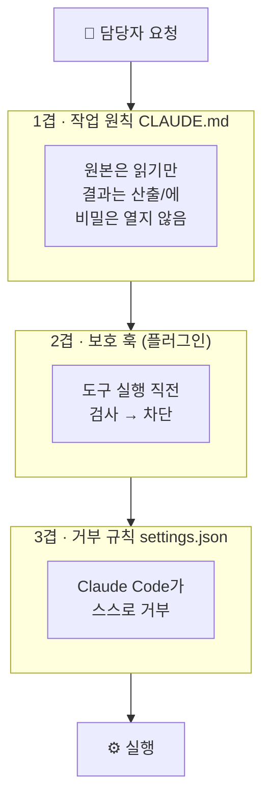

# 안전장치 — 무엇을, 어떻게 막나요

> 기록물은 한 번 잘못 지우거나 고치면 되돌릴 수 없습니다. 그래서 **AI가 실수하더라도 사고가 나지 않게** 여러 겹으로 막아 두었습니다.

[← 사용 안내로](README.md)

---

## 세 겹의 잠금



| 겹 | 무엇 | 비유 | 설치 |
|---|---|---|---|
| 1 | `CLAUDE.md` 작업 원칙 | 직원 수칙 | 작업 폴더에 복사 |
| 2 | **보호 훅** | 현관 보안요원 | 플러그인 설치 시 자동 |
| 3 | `.claude/settings.json` 거부 규칙 | 금고 자물쇠 | 작업 폴더에 복사 |

수칙(1겹)은 AI가 읽고 따르는 약속이고, 2겹·3겹은 **AI의 판단과 상관없이 기계적으로** 막습니다.

---

## 2겹 · 보호 훅이 막는 것

Claude가 파일을 읽거나 쓰거나 명령을 실행하기 **직전**에 훅이 검사합니다.

| 상황 | 결과 |
|---|---|
| 경로에 `비밀`·`secret`·`classified`가 들어감 — 읽기·쓰기·검색·명령 어느 것이든 | ⛔ 차단 |
| `원본`·`보존`·`originals`·`preserved` 폴더에 쓰기·수정 | ⛔ 차단 |
| 위 폴더로 파일을 옮기거나(`mv`) 덮어쓰는(`>`, `tee`, `sed -i`) 명령 | ⛔ 차단 |
| 삭제(`rm`, `rmdir`, `shred`, `unlink`) | ⛔ 차단 — 사람이 직접 |
| 외부 전송(`curl`, `wget`, `scp`, `rsync`, `ftp`, `sftp`) | ⛔ 차단 |
| 권한 변경(`chmod`), 원격 저장소 전송(`git push`) | ⛔ 차단 |
| 그 밖의 읽기·`산출/`에 새 파일 쓰기 | ✅ 통과 |

폴더 이름은 플러그인 설정(**Configure options**)에서 기관에 맞게 바꿀 수 있습니다 → [처음 시작하기 4단계](getting-started.md#선택-우리-기관-폴더-이름-알려-주기)

### 훅이 고장 나면?

보호가 **조용히 꺼지지 않도록** 만들었습니다.

- 컴퓨터에서 Python 3.8 이상을 `python3` → `python` → `py` 순서로 찾습니다. Windows의 Microsoft Store 안내용 가짜 `python3`는 건너뜁니다.
- **Python을 하나도 찾지 못하면 모든 작업을 막고** "Python 3.10 이상을 설치하세요"라고 알립니다.
- 훅 안에서 예상 못 한 오류가 나도 **막는 쪽**으로 끝납니다.

---

## 3겹 · 거부 규칙 (settings.json)

훅과 별개로 Claude Code 자체가 거부합니다. 훅이 어떤 이유로든 돌지 않아도 남는 잠금입니다.

| 거부 | 규칙 |
|---|---|
| `비밀/` 읽기·수정·쓰기 | `Read(./비밀/**)` 등 |
| `원본/`·`보존/` 수정·쓰기 | `Edit(./원본/**)` 등 |
| 삭제·외부 전송·원격 전송 | `Bash(rm:*)`, `Bash(curl:*)`, `Bash(wget:*)`, `Bash(git push:*)` |
| **실행 전 확인** | 이관 패키지 만들기(`make_bag.py`)는 매번 묻습니다 |

> 거부 규칙은 작업 폴더 기준(`./비밀/**`)입니다. 비밀 폴더 이름이 다르면 [`templates/.claude/settings.json`](../plugins/records-skills/templates/.claude/settings.json)의 이름도 같이 바꾸세요.

---

## 처리 기록 — 누가, 언제, 무엇을

Claude가 파일을 쓰거나 명령을 실행할 때마다 `logs/processing_log.jsonl`에 한 줄씩 남습니다.

```json
{"time_kst": "2026-11-20T10:31:05+09:00", "tool": "Write", "file": "산출/생산현황_2025.xlsx", "sha256": "4f1c…"}
```

- 시각은 한국 시간(KST)입니다.
- 새로 쓴 파일은 **SHA-256 해시**를 함께 적어 나중에 바뀌었는지 확인할 수 있습니다.
- 감사·인계 때 "AI가 무엇을 만들었는지" 보여 주는 근거가 됩니다.

---

## 설계 원칙 — 스크립트가 하지 않는 것

| 하지 않는 것 | 이유 |
|---|---|
| 폐기·이관·공개 **결정** | 법령상 심의·결재 사항 |
| 국가기록원·외부로 **제출·발송** | 제출 책임은 기관에 있음 |
| **비밀기록물** 열기·요약 | 비밀은 AI 처리 대상이 아님 |
| 원본 **덮어쓰기** | 진본성·무결성 |
| 결과 폴더 **덮어쓰기** | 이전 결과를 잃지 않게 — 비어 있지 않으면 멈춤 |

---

## 보호 장치 확인하기 (설치 후 한 번)

작업 폴더에 `비밀/시험.txt`를 만들고 Claude에게 `비밀/시험.txt 읽어줘`라고 해 보세요.

- **"차단"** 또는 거부 메시지 → 정상 ✅
- 내용을 읽어 줌 → [문제 해결](faq.md#보호-장치가-작동하지-않아요)

---

## 기관 보안 담당자에게 보여 줄 요약

- 개인 PC의 Claude Code에서 돌고, 입력 파일은 **담당자가 고른 작업 폴더**에서만 읽습니다.
- Claude Code는 대화 내용(읽은 파일 일부 포함)을 Anthropic 서버로 보내 처리합니다. **비밀·비공개 원문은 처음부터 작업 폴더에 두지 마세요.** 기관 보안 규정이 우선합니다.
- 스크립트는 인터넷에 접속하지 않습니다. 예외: 웹기록물 점검(`web-records-check --url`)은 기관 누리집에 접속합니다.
- 코드는 모두 이 저장소에 공개되어 있어 검토할 수 있습니다(MIT).
